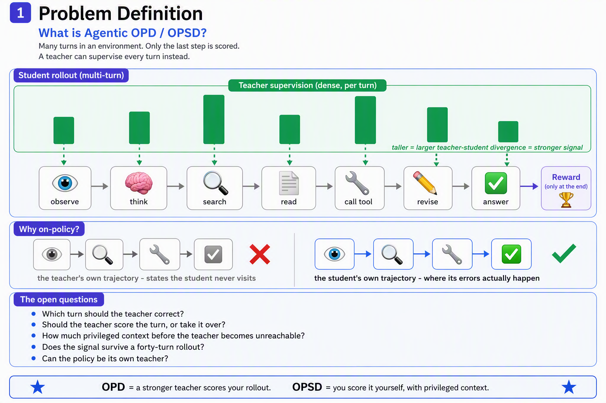

# Awesome-Agentic-OPD

A curated list of papers, benchmarks, methods, and resources for **On-Policy Distillation (OPD) and On-Policy Self-Distillation (OPSD) in Agentic RL**.

> **Our work.** We propose [UniOPSD: Unifying Outcome and Hindsight Feedback for Agentic Reinforcement Learning](https://arxiv.org/abs/2609.34810), a unified framework that combines outcome feedback with successful-peer hindsight for correlation-guided credit assignment in agentic RL. [Code](https://github.com/Zenghuang-Fu/Uniopsd).

**Scope.** A paper belongs here when it satisfies *both* conditions:

1. **Agentic** — the policy takes **more than one turn** in an environment (tool calls, retrieval, GUI actions, code execution), so per-step errors compound and a trajectory-level reward does not say *which* action was wrong.
2. **On-policy distillation** — a teacher-derived signal (an external teacher, or the same policy conditioned on privileged context) supplies a **distillation objective on the agent's own rollouts** and updates the weights.

Section 8 is the one exception to condition 2: it collects environments, testbeds and training frameworks that *serve* agentic OPD research without themselves training a policy.

Explicitly **out of scope**: single-turn OPD; off-policy distillation and SFT on teacher trajectories; "distillation" that only writes text into a memory or skill library without a distillation loss; training-free and gradient-free agent transfer; non-LLM robotic policy distillation; general-purpose LLM technical reports that are not about multi-turn agents. Single-turn foundations appear only in a short [Preliminaries](#-preliminaries-single-turn-opd--opsd) section that fixes the definitions.

---

## 📢 News

- 🚀 2026-08-06: Repository initialized.
- 📝 2026-08-06: Taxonomy for agentic OPD / OPSD released (8 categories).
- ✅ 2026-08-06: All titles, dates, venues and code links verified programmatically against the arXiv API.
- 🧹 2026-08-06: Inclusion criteria tightened and written down. Every entry re-checked against its abstract for an actual on-policy distillation objective; 26 entries removed that used "distil" only figuratively, distilled off-policy, distilled into something other than the policy, or wrote to a text memory instead of the weights.
- ➕ 2026-08-07: Three new entries — AgentOPSD (recursive turn-level credit), MemOPD (teacher state alignment under memory compression) and SMRC-SD (state-matched privileged routing).

---

## 📚 Table of Contents

- [Awesome-Agentic-OPD](#awesome-agentic-opd)
  - [📢 News](#-news)
  - [🧭 Taxonomy](#-taxonomy)
    - [1️⃣ Trajectory-Level Agentic OPD](#1️⃣-trajectory-level-agentic-opd)
    - [2️⃣ Turn- and Step-Level OPD / OPSD](#2️⃣-turn--and-step-level-opd--opsd)
    - [3️⃣ Privileged- and Hindsight-Conditioned OPSD](#3️⃣-privileged--and-hindsight-conditioned-opsd)
    - [4️⃣ Token- and Advantage-Level Credit in Agentic OPD](#4️⃣-token--and-advantage-level-credit-in-agentic-opd)
    - [5️⃣ Teacher Construction and Multi-Teacher Agentic OPD](#5️⃣-teacher-construction-and-multi-teacher-agentic-opd)
    - [6️⃣ Skill and Experience Distillation for Self-Evolving Agents](#6️⃣-skill-and-experience-distillation-for-self-evolving-agents)
    - [7️⃣ Domain Agents: Search, GUI, Dialogue, Recommendation](#7️⃣-domain-agents-search-gui-dialogue-recommendation)
    - [8️⃣ Benchmarks, Environments and Frameworks](#8️⃣-benchmarks-environments-and-frameworks)
  - [📎 Preliminaries: Single-Turn OPD / OPSD](#-preliminaries-single-turn-opd--opsd)
  - [📄 Papers](#-papers)
  - [🤝 Contributing](#-contributing)
  - [⭐ Star History](#-star-history)

---

## 🧭 Taxonomy

### 1️⃣ Trajectory-Level Agentic OPD

Distillation supervised at whole-rollout granularity: rollout depth curricula, prefix replay, teacher bridges validated by the student's own continuation, and trajectory-level critique of failed rollouts.

### 2️⃣ Turn- and Step-Level OPD / OPSD

Supervision aligned to the agent's decision points: per-turn intervention and switching, turn-normalized losses, turn-level credit from a teacher, step-level preference distillation, curricula over turns.

### 3️⃣ Privileged- and Hindsight-Conditioned OPSD

Self-teachers conditioned on what the student never sees — gold answers, retrieved evidence, future observations, skills, reflections, sibling rollouts — and the privilege-illusion / hindsight-leakage problem this creates.

### 4️⃣ Token- and Advantage-Level Credit in Agentic OPD

Turning teacher disagreement into token-level credit inside a policy-gradient update: adaptive granularity, counterfactual sibling credit, action-token reweighting, and bounded advantage reshaping that keeps RL in charge of the actor.

### 5️⃣ Teacher Construction and Multi-Teacher Agentic OPD

Choosing and building the teacher for agentic tasks: teacher debate, domain-routed multi-teacher OPD (MOPD), specialize-then-unify, tool-call support truncation, and agentic models that ship MOPD in production.

### 6️⃣ Skill and Experience Distillation for Self-Evolving Agents

Converting completed rollouts into skills, hindsight experience or world-model updates, then distilling their behavioural effect back into the weights on-policy. Excludes memory architectures that only write text and never touch the policy.

### 7️⃣ Domain Agents: Search, GUI, Dialogue, Recommendation

Agentic OPD / OPSD instantiated per domain — deep search and RAG agents, computer-use agents, task-oriented dialogue and agentic recommenders — including the negative result on when a self-teacher fails to help.

### 8️⃣ Benchmarks, Environments and Frameworks

Environments and testbeds for dense supervision in long-horizon agents, and open-source frameworks that implement agentic OPD.

---

## 📎 Preliminaries: Single-Turn OPD / OPSD

Single-turn work, included **only** so the objectives used throughout this list are defined: reverse-KL minimization over student-sampled sequences (OPD), and the same-model teacher conditioned on privileged context (OPSD). Not part of the list's subject matter.

| 📖 Title | 🛠 Model / Method | 📅 Date | 💻 Code | 🏛 Venue |
| --- | --- | --- | --- | --- |
| [On-Policy Distillation of Language Models: Learning from Self-Generated Mistakes](https://arxiv.org/abs/2306.13649) | GKD | 2023-06 | - | ICLR |
| [MiniLLM: On-Policy Distillation of Large Language Models](https://arxiv.org/abs/2306.08543) | MiniLLM | 2023-06 | [Code](https://github.com/microsoft/LMOps/tree/main/minillm) | ICLR |
| [Speculative Knowledge Distillation: Bridging the Teacher-Student Gap Through Interleaved Sampling](https://arxiv.org/abs/2410.11325) | SKD | 2024-10 | - | ICLR |
| [Self-Distilled Reasoner: On-Policy Self-Distillation for Large Language Models](https://arxiv.org/abs/2601.18734) | OPSD | 2026-01 | [Code](https://github.com/siyan-zhao/OPSD) | arXiv |
| [A Survey of On-Policy Distillation for Large Language Models](https://arxiv.org/abs/2604.00626) | Survey | 2026-04 | - | arXiv |

---

## 📄 Papers

### 1️⃣ Trajectory-Level Agentic OPD

| 📖 Title | 🛠 Model / Method | 📅 Date | 💻 Code | 🏛 Venue |
| --- | --- | --- | --- | --- |
| [TCOD: Exploring Temporal Curriculum in On-Policy Distillation for Multi-turn Autonomous Agents](https://arxiv.org/abs/2604.24005) | TCOD | 2026-04 | [Code](https://github.com/kokolerk/TCOD) | arXiv |
| [Multi-Turn On-Policy Distillation with Prefix Replay](https://arxiv.org/abs/2607.04763) | ReOPD | 2026-07 | - | arXiv |
| [Look Ahead Before You Distill: Future Trajectory Validation of Teacher Guidance for Agentic On-Policy Distillation](https://arxiv.org/abs/2608.01953) | FutureBridge-OPD | 2026-08 | [Code](https://github.com/ChenChiShui/FutureBridge-OPD) | arXiv |
| [HindSearch: Trajectory-Level Hindsight Critique for Search-Augmented Reinforcement Learning](https://arxiv.org/abs/2608.01597) | HindSearch | 2026-08 | - | arXiv |

### 2️⃣ Turn- and Step-Level OPD / OPSD

| 📖 Title | 🛠 Model / Method | 📅 Date | 💻 Code | 🏛 Venue |
| --- | --- | --- | --- | --- |
| [UI-Voyager: A Self-Evolving GUI Agent Learning via Failed Experience](https://arxiv.org/abs/2603.24533) | Group Relative Self-Distillation | 2026-03 | [Code](https://github.com/ui-voyager/UI-Voyager) | arXiv |
| [SOD: Step-wise On-policy Distillation for Small Language Model Agents](https://arxiv.org/abs/2605.07725) | SOD | 2026-05 | [Code](https://github.com/YoungZ365/SOD) | arXiv |
| [StepOPSD: Step-Aware Online Preference Distillation for Agent Reinforcement Learning](https://arxiv.org/abs/2605.27140) | StepOPSD | 2026-05 | - | arXiv |
| [On-Policy Distillation with Curriculum Turn-level Guidance for Multi-turn Agents](https://arxiv.org/abs/2606.15912) | Guided-OPD | 2026-06 | - | arXiv |
| [SAGE-OPD: Selective Agent-Guided Intervention for Multi-Turn On-Policy Distillation](https://arxiv.org/abs/2606.19659) | SAGE-OPD | 2026-06 | - | arXiv |
| [ATOD: Annealed Turn-Aware On-Policy Distillation for Multi-Turn Agentic Tasks](https://arxiv.org/abs/2606.27814) | ATOD | 2026-06 | - | arXiv |
| [TurnOPD: Making On-Policy Distillation Turn-Aware for Efficient Long-Horizon Agent Training](https://arxiv.org/abs/2607.05804) | TurnOPD | 2026-07 | - | arXiv |
| [CAST: Game Solvers as Turn-Level Teachers for LLM Agents](https://arxiv.org/abs/2607.25308) | CAST | 2026-07 | [Code](https://github.com/Wloner0809/CAST) | arXiv |
| [DASH-OPD: Discrepancy-Aware Switching with Hysteresis for On-Policy Distillation](https://arxiv.org/abs/2607.29078) | DASH-OPD | 2026-07 | [Code](https://github.com/Lucian1115/DASH-OPD) | arXiv |
| [TurnSight: Turn-Level Hindsight Self-Distillation for Tool-Integrated Reasoning](https://arxiv.org/abs/2608.04007) | TurnSight | 2026-08 | [Code](https://github.com/quchangle1/TurnSight) | arXiv |
| [AgentOPSD: Recursive Self-Distillation for Agentic Reinforcement Learning](https://arxiv.org/abs/2608.05987) | AgentOPSD | 2026-08 | [Code](https://github.com/ZethWang/AgentOPSD) | arXiv |
| [MemOPD: On-Policy Distillation through Memory State Alignment for Long-Horizon Agents](https://arxiv.org/abs/2608.07068) | MemOPD | 2026-08 | - | arXiv |

### 3️⃣ Privileged- and Hindsight-Conditioned OPSD

| 📖 Title | 🛠 Model / Method | 📅 Date | 💻 Code | 🏛 Venue |
| --- | --- | --- | --- | --- |
| [Privileged Information Distillation for Language Models](https://arxiv.org/abs/2602.04942) | π-Distill / OPSD | 2026-02 | - | arXiv |
| [Skill-SD: Skill-Conditioned Self-Distillation for Multi-turn LLM Agents](https://arxiv.org/abs/2604.10674) | Skill-SD | 2026-04 | [Code](https://k1xe.github.io/skill-sd/) | arXiv |
| [π-Play: Multi-Agent Self-Play via Privileged Self-Distillation without External Data](https://arxiv.org/abs/2604.14054) | π-Play | 2026-04 | [Code](https://github.com/zhyaoch/pi-play) | arXiv |
| [Self-Distilled Agentic Reinforcement Learning](https://arxiv.org/abs/2605.15155) | SDAR | 2026-05 | - | arXiv |
| [HINT-SD: Targeted Hindsight Self-Distillation for Long-Horizon Agents](https://arxiv.org/abs/2605.17873) | HINT-SD | 2026-05 | - | arXiv |
| [SD-Search: On-Policy Hindsight Self-Distillation for Search-Augmented Reasoning](https://arxiv.org/abs/2605.18299) | SD-Search | 2026-05 | - | arXiv |
| [Same Evidence, Different Answers: Canonical-Context On-Policy Distillation for Multi-Turn Language Models](https://arxiv.org/abs/2605.30251) | CCOPD | 2026-05 | - | arXiv |
| [PBSD: Privileged Bayesian Self-Distillation for Long-Horizon Credit Assignment](https://arxiv.org/abs/2606.09348) | PBSD | 2026-06 | - | arXiv |
| [HERO: Hindsight-Enhanced Reflection from Environment Observations for Agentic Self-Distillation](https://arxiv.org/abs/2606.11559) | HERO | 2026-06 | - | arXiv |
| [UCOB: Learning to Utilize and Evolve Agentic Skills via Credit-Aware On-Policy Bidirectional Self-Distillation](https://arxiv.org/abs/2606.29502) | UCOB | 2026-06 | [Code](https://github.com/TU2021/UCOB) | arXiv |
| [KbSD: Knowledge Boundary aware Self-Distillation for Behavioral Calibration in Agentic Search](https://arxiv.org/abs/2606.29863) | KbSD | 2026-06 | - | arXiv |
| [From Scoring to Acting: Outcome-Verified Comparative Self-Distillation for LLM Agents](https://arxiv.org/abs/2607.27937) | OVCSD | 2026-07 | - | arXiv |
| [Contrastive Reinforced Policy Optimization via Privileged Self-Distillation](https://arxiv.org/abs/2607.28026) | CRPO | 2026-07 | - | arXiv |
| [Group-Reflective Self-Distillation for Agentic Reinforcement Learning](https://arxiv.org/abs/2607.28076) | GRSD | 2026-07 | - | arXiv |
| [TransMem: Transforming Hidden States into Memory for Large Language Models](https://arxiv.org/abs/2607.29032) | TransMem | 2026-07 | [Code](https://github.com/Haodong-Lei-Ray/TransMem) | arXiv |
| [EviSD: Evidence-Conditioned Self-Distillation for Search-Augmented Agents](https://arxiv.org/abs/2608.01359) | EviSD | 2026-08 | [Code](https://github.com/JiananXie/EviSD) | arXiv |
| [PCSD: Persistent Consistency for Self-Distillation in Agentic Reinforcement Learning](https://arxiv.org/abs/2608.01837) | PCSD | 2026-08 | - | arXiv |
| [Agentic Reinforcement Learning with Self-Distilled Reward Shaping](https://arxiv.org/abs/2608.03223) | ADRS | 2026-08 | [Code](https://github.com/gitrxh/ADRS-arxiv) | arXiv |
| [Agentic Reinforcement Learning with Observation-Calibrated Self-Distillation](https://arxiv.org/abs/2608.04788) | OCSD | 2026-08 | [Code](https://github.com/yiy1x/OCSD) | arXiv |
| [Privileged, but Biased: How PI-Conditioned Teachers Break Self-Distillation](https://arxiv.org/abs/2608.04794) | PI Bias Score | 2026-08 | - | arXiv |
| [When Privileged Guidance Misaligns: State-Matched Routing and Contextualized Self-Distillation for Multi-Turn Agents](https://arxiv.org/abs/2608.05219) | SMRC-SD | 2026-08 | [Code](https://github.com/liujunzhuo/SMRC-SD) | arXiv |
| [UniOPSD: Unifying Outcome and Hindsight Feedback for Agentic Reinforcement Learning](https://arxiv.org/abs/2609.34810) | UniOPSD | 2026-09 | [Code](https://github.com/Zenghuang-Fu/Uniopsd) | arXiv |

### 4️⃣ Token- and Advantage-Level Credit in Agentic OPD

| 📖 Title | 🛠 Model / Method | 📅 Date | 💻 Code | 🏛 Venue |
| --- | --- | --- | --- | --- |
| [GEAR: Granularity-Adaptive Advantage Reweighting for LLM Agents via Self-Distillation](https://arxiv.org/abs/2605.11853) | GEAR | 2026-05 | - | arXiv |
| [Keep Policy Gradient in Charge: Sibling-Guided Credit Distillation for Long-Horizon Tool-Use Agents](https://arxiv.org/abs/2606.12634) | SGCD | 2026-06 | - | arXiv |
| [CRAFT: Counterfactual Credit Assignment from Free Sibling Rollouts for Self-Distilled Agentic Reinforcement Learning](https://arxiv.org/abs/2606.29476) | CRAFT | 2026-06 | - | arXiv |
| [MAGA: Multi-Platform Self-Fusion of GUI Agents via Structured Action Distillation](https://arxiv.org/abs/2607.29320) | MAGA | 2026-07 | - | arXiv |

### 5️⃣ Teacher Construction and Multi-Teacher Agentic OPD

| 📖 Title | 🛠 Model / Method | 📅 Date | 💻 Code | 🏛 Venue |
| --- | --- | --- | --- | --- |
| [KAT-Coder-V2 Technical Report](https://arxiv.org/abs/2603.27703) | KAT-Coder-V2 | 2026-03 | - | arXiv |
| [MAD-OPD: Breaking the Ceiling in On-Policy Distillation via Multi-Agent Debate](https://arxiv.org/abs/2605.01347) | MAD-OPD | 2026-05 | [Code](https://github.com/chiefovoavicii/MAD-OPD) | arXiv |
| [Scaling the Horizon, Not the Parameters: Reaching Trillion-Parameter Performance with a 35B Agent](https://arxiv.org/abs/2606.30616) | Agents-A1 | 2026-06 | [Code](https://github.com/InternScience/Agents-A1) | arXiv |
| [UI-MOPD: Multi-Platform On-Policy Distillation for Continual GUI Agent Learning](https://arxiv.org/abs/2607.04425) | UI-MOPD | 2026-07 | [Code](https://elispectre.github.io/UI-MOPD/) | arXiv |
| [KAT-Coder-V2.5 Technical Report](https://arxiv.org/abs/2607.05471) | KAT-Coder-V2.5 | 2026-07 | - | arXiv |
| [When Top-K Misses the Decision: Tool-Call Drift in Multi-Teacher On-Policy Distillation](https://arxiv.org/abs/2607.07050) | - | 2026-07 | [Code](https://github.com/shen-jiabin/topk-support-opd) | arXiv |
| [Mach-Mind-4-Flash Technical Report](https://arxiv.org/abs/2607.09375) | MOPD / HMPO | 2026-07 | - | arXiv |
| [The Physics of Multi-Turn Long-Horizon Planning: From Pre-training to Post-training via Single- and Multi-Teacher On-Policy Agentic Distillation](https://arxiv.org/abs/2607.24720) | MOPD | 2026-07 | - | arXiv |
| [Cross-Domain Hybrid OPD for Generalizable Search Agents](https://arxiv.org/abs/2608.02101) | Yuanbao Search Agent | 2026-08 | - | arXiv |

### 6️⃣ Skill and Experience Distillation for Self-Evolving Agents

| 📖 Title | 🛠 Model / Method | 📅 Date | 💻 Code | 🏛 Venue |
| --- | --- | --- | --- | --- |
| [OPD-Evolver: Cultivating Holistic Agent Evolver via On-Policy Distillation](https://arxiv.org/abs/2606.17628) | OPD-Evolver | 2026-06 | - | arXiv |
| [OPID: On-Policy Skill Distillation for Agentic Reinforcement Learning](https://arxiv.org/abs/2606.26790) | OPID | 2026-06 | [Code](https://github.com/jinyangwu/OPID) | arXiv |
| [DeepSearch-World: Self-Distillation for Deep Search Agents in a Verifiable Environment](https://arxiv.org/abs/2607.07820) | DeepSearch-World | 2026-07 | - | arXiv |
| [SEED: Self-Evolving On-Policy Distillation for Agentic Reinforcement Learning](https://arxiv.org/abs/2607.14777) | SEED | 2026-07 | [Code](https://github.com/jinyangwu/SEED) | arXiv |

### 7️⃣ Domain Agents: Search, GUI, Dialogue, Recommendation

| 📖 Title | 🛠 Model / Method | 📅 Date | 💻 Code | 🏛 Venue |
| --- | --- | --- | --- | --- |
| [Can Compact Language Models Search Like Agents? Distillation-Guided Policy Optimization for Preserving Agentic RAG Capabilities](https://arxiv.org/abs/2508.20324) | DGPO | 2025-08 | - | ACL(Main) |
| [Self-Distilled Reinforcement Learning for Co-Evolving Agentic Recommender Systems](https://arxiv.org/abs/2604.10029) | CoARS | 2026-04 | - | arXiv |
| [HyperEyes: Dual-Grained Efficiency-Aware Reinforcement Learning for Parallel Multimodal Search Agents](https://arxiv.org/abs/2605.07177) | HyperEyes | 2026-05 | [Code](https://github.com/DeepExperience/HyperEyes) | arXiv |
| [Unlocking Proactivity in Task-Oriented Dialogue](https://arxiv.org/abs/2605.22240) | Asymmetric-View Policy Optimization | 2026-05 | - | arXiv |
| [Search-E1: Self-Distillation Drives Self-Evolution in Search-Augmented Reasoning](https://arxiv.org/abs/2605.22511) | Search-E1 | 2026-05 | - | arXiv |
| [Teach it to stop, not just to click](https://arxiv.org/abs/2607.17136) | SA-OPSD | 2026-07 | - | arXiv |
| [Why Does Feedback-Augmented Self-Distillation Fail to Improve Retrieval-Interleaved Search Agents?](https://arxiv.org/abs/2607.17558) | FA-SD | 2026-07 | - | arXiv |

### 8️⃣ Benchmarks, Environments and Frameworks

| 📖 Title | 🛠 Benchmark / Framework | 📅 Date | 💻 Code | 🏛 Venue |
| --- | --- | --- | --- | --- |
| [Healthcare AI GYM for Medical Agents](https://arxiv.org/abs/2605.02943) | TT-OPD | 2026-05 | - | arXiv |
| [Orchard: An Open-Source Agentic Modeling Framework](https://arxiv.org/abs/2605.15040) | Orchard | 2026-05 | - | arXiv |
| [QVal: Cheaply Evaluating Dense Supervision Signals for Long-Horizon LLM Agents](https://arxiv.org/abs/2606.32034) | QVal | 2026-06 | - | arXiv |
| [DeepSearch-World: Self-Distillation for Deep Search Agents in a Verifiable Environment](https://arxiv.org/abs/2607.07820) | DeepSearch-World | 2026-07 | - | arXiv |
| [EasyOPD: An Easy-to-use On-Policy Distillation Framework for Large Language Models](https://arxiv.org/abs/2607.11012) | EasyOPD | 2026-07 | - | arXiv |
| [More Methods, Better Agents? A Reality Check on Self-Distillation in Agentic Reinforcement Learning](https://arxiv.org/abs/2610.19789) | Self-Distillation-AgentRL | 2026-10 | [Code](https://github.com/aim-uofa/Self-Distillation-AgentRL) | arXiv |

---

## 🤝 Contributing

- Found an agentic OPD / OPSD paper, benchmark, or codebase that is missing? Open a pull request or an issue.
- Spotted wrong metadata (venue, date, method name, broken link)? Corrections are very welcome.
- Have a suggestion for the taxonomy — a category to split, merge, or add? Please open an issue to discuss.
- Papers may appear under more than one category when they contribute along multiple axes.
- **Before submitting, check the two conditions in [Scope](#awesome-agentic-opd).** The most common false positive is a paper that uses the word "distil" for summarizing trajectories into a text memory or skill library: that is not a distillation objective and does not belong here. The second most common is supervised fine-tuning on teacher trajectories, which is off-policy.
- Metadata provenance: every title and date is taken from the arXiv API; `🏛 Venue` is only set to a conference when the paper's own arXiv `comment`/`journal_ref` states the acceptance, otherwise it stays `arXiv`; every `💻 Code` link is one announced in the paper itself and returned HTTP 200 at indexing time.

---

## ⭐ Star History

